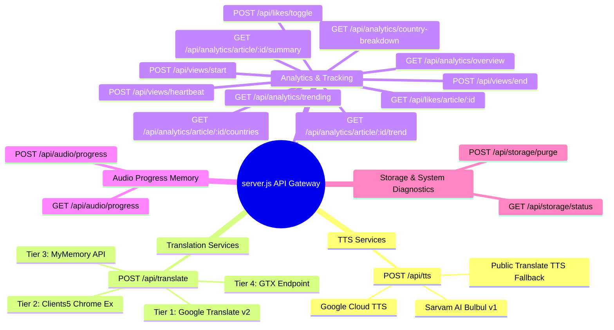
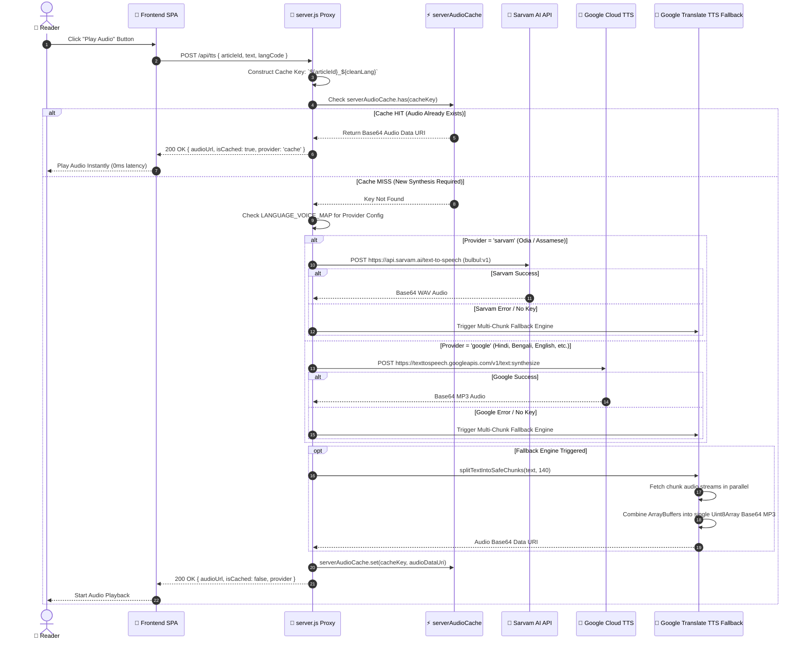
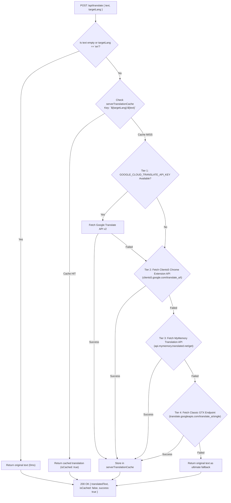
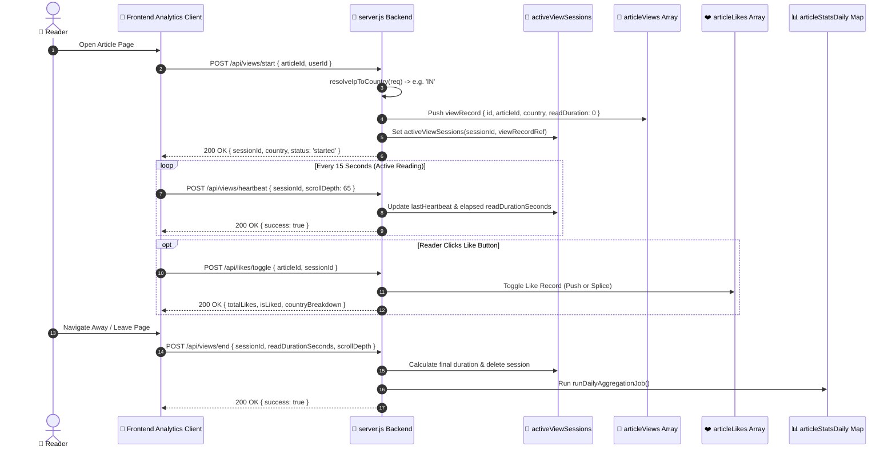
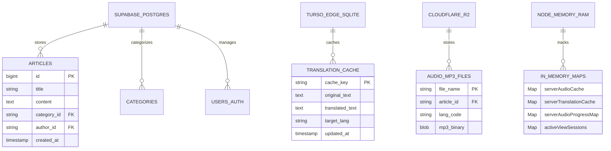

# 🏗️ PublicSpark — Complete Backend Architecture & Mermaid System Guide

**Project:** PublicSpark Digital Newsroom Platform  
**Backend Runtime:** Node.js Native HTTP Proxy Server (`server/server.js`) on `http://localhost:5000`  
**Dependencies:** **0 External NPM Packages** (Built strictly using Node.js native `http` module and Standard Web APIs)  
**Architecture Goal:** **₹0 Direct Monthly Infrastructure Cost** with Sub-50ms Response Speed, High-Definition Multilingual TTS, Multi-Tier Translation, Real-Time Analytics, and Multi-DB Storage Safeguards.  
**Version:** 4.0.0 (Unified Master Architecture Diagram Specification)  

---

## 🌟 UNIFIED MASTER BACKEND ARCHITECTURE DIAGRAM (Pura Backend Ek Hi Diagram Me)

Is single diagram me **Frontend SPA**, **Node.js Native Proxy Gateway (`server/server.js`)**, **All REST API Endpoints**, **In-Memory Caches**, **Geolocation & Fallback Engines**, **All External AI Providers (TTS & Translation Tiers)**, aur **Multi-DB Storage Infrastructure (Supabase, Turso, Cloudflare R2)** ko ek saath connect karke dikhaya gaya hai:

```mermaid
flowchart TD
    %% ==========================================
    %% UNIFIED MASTER BACKEND ARCHITECTURE DIAGRAM
    %% ==========================================

    subgraph CLIENT_LAYER ["📱 1. Client Browser SPA Layer (React 19 / Vite)"]
        UI_SPA["React SPA UI\n(Reader & Admin)"]
        Audio_Player["Audio Player & Speech Engine"]
        Trans_Comp["18-Lang Switcher"]
        Analytics_Tracker["Analytics & Heartbeat Client\n(Sends ping every 15s)"]
    end

    subgraph BACKEND_GATEWAY ["🚀 2. Node.js Native HTTP Proxy Server (server/server.js on Port 5000)"]
        HTTP_Router{"HTTP API Router\n(CORS & Secret Key Shield)"}

        subgraph RAM_CACHES ["⚡ In-Memory RAM Caching & State Store"]
            Cache_Audio[("serverAudioCache\nMap<cacheKey, Base64_MP3>")]
            Cache_Trans[("serverTranslationCache\nMap<targetLang:text, Translation>")]
            Cache_Progress[("serverAudioProgressMap\nMap<article_lang, PositionSecs>")]
            Cache_Sessions[("activeViewSessions\nMap<sessionId, LiveSessionState>")]
            Log_Views["articleViews Log Array\n(Raw Reading Events)"]
            Log_Likes["articleLikes Log Array\n(Raw Like Toggles)"]
            Map_DailyStats[("articleStatsDaily\nMap<articleId_date, Summary>")]
        end

        subgraph CORE_ENGINES ["🧠 Backend Processing & Geolocation Engines"]
            Engine_Geo["IP Geolocation Resolver\n(resolveIpToCountry)\ncf-ipcountry -> x-forwarded-for -> IP Hash"]
            Engine_TTSChunker["Safe Audio Chunker\n(splitTextIntoSafeChunks 140 chars\n+ Base64 MP3 Buffer Stitcher)"]
            Engine_Cron["Daily Aggregation Cron Job\n(setInterval 30 mins -> Aggregates Views,\nUniques, Avg Duration & Countries)"]
        end

        subgraph API_ENDPOINTS ["🔌 REST API Endpoint Handlers"]
            EP_TTS["POST /api/tts\n(18-Language Voice Router)"]
            EP_Translate["POST /api/translate\n(4-Tier Fallback Translator)"]
            EP_Views["POST /api/views/start\nPOST /api/views/heartbeat\nPOST /api/views/end"]
            EP_Likes["POST /api/likes/toggle\nGET /api/likes/article/:id"]
            EP_Analytics["GET /api/analytics/overview\nGET /api/analytics/trending\nGET /api/analytics/country-breakdown"]
            EP_Progress["POST /api/audio/progress\nGET /api/audio/progress"]
            EP_Storage["GET /api/storage/status\nPOST /api/storage/purge"]
            EP_Settings["GET & POST /api/settings/social\nGET & POST /api/categories\n(File Persistence server/data/*.json)"]
        end
    end

    subgraph AI_SERVICES ["🤖 3. External AI APIs & Multi-Tier Fallbacks"]
        subgraph TTS_PROVIDERS ["Text-To-Speech Providers"]
            AI_GoogleTTS["Google Cloud TTS API\n(Neural2 & Wavenet Models)"]
            AI_Sarvam["Sarvam AI API (bulbul:v1)\n(Odia & Assamese Speakers)"]
            AI_TTSFallback["Google Translate TTS Fallback\n(Zero-Cost Multi-Chunk Synthesis)"]
        end

        subgraph TRANS_TIERS ["Translation Tier Architecture"]
            Tier1_Google["Tier 1: Google Cloud Translate v2 API\n(Official API Key)"]
            Tier2_Clients5["Tier 2: Clients5 Chrome Extension API\n(Fast Free Fallback)"]
            Tier3_MyMemory["Tier 3: MyMemory Translation API\n(Secondary Fallback)"]
            Tier4_GTX["Tier 4: Google GTX Single Endpoint\n(Final Fallback)"]
        end
    end

    subgraph STORAGE_TIERS ["🗄️ 4. Multi-Tier Infrastructure & Database System"]
        DB_Supabase[("Tier 1: Supabase PostgreSQL (Master DB)\n• Articles, Categories, User Auth, Roles\n• Row Level Security (RLS) & WebSockets\n• Free Limit: 500 MB DB / 50k MAU")]
        DB_Turso[("Tier 2: Turso LibSQL Edge SQLite\n• 18-Language Cached Article Translations\n• Ultra Low Latency (<10ms Edge Reads)\n• Free Limit: 9 GB / 1 Billion Reads/mo")]
        Storage_R2[("Tier 3: Cloudflare R2 Object Storage\n• Generated MP3 Audio Files & WebP Images\n• Zero Egress Bandwidth Fees\n• Free Limit: 10 GB Storage / 10M Ops")]
        Storage_RAM[("Tier 4: Server RAM Memory\n• Instant 0ms Execution State & Cache Locks\n• In-Memory Map Purge System")]
    end

    %% ==========================================
    %% DATA & CONTROL FLOW CONNECTIONS
    %% ==========================================

    %% Client SPA to Gateway Router Connections
    Audio_Player -->|"1. Request Audio Synthesis"| EP_TTS
    Trans_Comp -->|"2. Request Article Translation"| EP_Translate
    Analytics_Tracker -->|"3. Start / Heartbeat / End Session"| EP_Views
    UI_SPA -->|"4. Toggle Like / Fetch Likes"| EP_Likes
    UI_SPA -->|"5. Fetch Analytics Dashboard"| EP_Analytics
    Audio_Player -->|"6. Save / Fetch Playback Position"| EP_Progress
    UI_SPA -->|"7. Monitor Quota & Purge Cache"| EP_Storage

    %% Router routing to Endpoints
    HTTP_Router --> EP_TTS
    HTTP_Router --> EP_Translate
    HTTP_Router --> EP_Views
    HTTP_Router --> EP_Likes
    HTTP_Router --> EP_Analytics
    HTTP_Router --> EP_Progress
    HTTP_Router --> EP_Storage

    %% EP_TTS Flow
    EP_TTS -->|"Check Cache First"| Cache_Audio
    Cache_Audio -.->|"Cache HIT: Return Base64 MP3"| EP_TTS
    EP_TTS -->|"Cache MISS: Check Voice Map"| AI_Sarvam
    EP_TTS -->|"Cache MISS: Check Voice Map"| AI_GoogleTTS
    AI_Sarvam -.->|"If Key Missing or Error"| Engine_TTSChunker
    AI_GoogleTTS -.->|"If Key Missing or Error"| Engine_TTSChunker
    Engine_TTSChunker --> AI_TTSFallback
    AI_TTSFallback -.->|"Save Synthesized MP3"| Cache_Audio

    %% EP_Translate Flow
    EP_Translate -->|"Check Cache First"| Cache_Trans
    Cache_Trans -.->|"Cache HIT: Return Text"| EP_Translate
    EP_Translate -->|"Cache MISS: Try Tier 1"| Tier1_Google
    Tier1_Google -.->|"If Fail -> Try Tier 2"| Tier2_Clients5
    Tier2_Clients5 -.->|"If Fail -> Try Tier 3"| Tier3_MyMemory
    Tier3_MyMemory -.->|"If Fail -> Try Tier 4"| Tier4_GTX
    Tier1_Google -.->|"Save Result"| Cache_Trans
    Tier2_Clients5 -.->|"Save Result"| Cache_Trans
    Tier3_MyMemory -.->|"Save Result"| Cache_Trans
    Tier4_GTX -.->|"Save Result"| Cache_Trans

    %% EP_Views & Geolocation Flow
    EP_Views --> Engine_Geo
    Engine_Geo --> Cache_Sessions
    Engine_Geo --> Log_Views
    EP_Views --> Log_Views

    %% Likes Flow
    EP_Likes --> Engine_Geo
    Engine_Geo --> Log_Likes

    %% Cron Job Flow
    Engine_Cron -->|"Reads Raw Events"| Log_Views
    Engine_Cron -->|"Aggregates Daily Stats"| Map_DailyStats
    EP_Analytics -->|"Reads Aggregations"| Map_DailyStats

    %% Progress Flow
    EP_Progress <--> Cache_Progress

    %% Storage & Storage Tier Sync
    EP_Storage --> Storage_RAM
    EP_Storage -.->|"Syncs Master Data"| DB_Supabase
    Cache_Trans -.->|"Syncs Edge Translations"| DB_Turso
    Cache_Audio -.->|"Uploads Static MP3 Assets"| Storage_R2
```



---

## 📌 Executive Summary (Backend Kaise Kaam Kar Raha Hai?)

PublicSpark ka backend zero-cost, high-performance architecture par design kiya gaya hai. Isme koi heavy Express ya framework installation ki zaroorat nahi hai. Yeh poora backend Node.js ke standard `node:http` module par chal raha hai aur iske 5 main pillars hain:

1. **Proxy & API Key Shielding**: AI Provider API keys (Google Cloud TTS, Sarvam AI, Google Translate) ko server-side environment variables (`.env`) me hide karke rakhta hai taaki client-side me leak na ho.
2. **Multi-Tier AI Fallback Engine**: Agar Google Cloud ya Sarvam AI keys absent hon ya quote finish ho jaye, toh backend automatically zero-cost fallback APIs (Translate TTS chunking, Clients5 Chrome API, MyMemory, GTX) me switch ho jata hai.
3. **In-Memory Speed & Caching Layer**: Audio synthesis aur Translations ko internal JavaScript `Map()` collections (`serverAudioCache`, `serverTranslationCache`) me store karta hai taaki redundant API calls zero hon.
4. **Real-Time Analytics & Heartbeat Engine**: Users ke reading session, scroll depth, country IP geolocation, and active duration ko track karta hai. Every 30 minutes cron job se aggregations run karta hai.
5. **Multi-DB Storage Strategy**: PostgreSQL (Supabase), LibSQL Edge SQLite (Turso), Cloudflare R2 Object Storage, aur Server RAM ko distribute karke ₹0 free tier limit me operational rakhta hai.

---

## ⚡ 2. Backend API Endpoint Map

Backend Proxy server par all available REST API Endpoints and unki responsibility:



---

## 🎙️ 3. Text-to-Speech (TTS) Flow & Voice Routing Engine

Backend `/api/tts` endpoint 18 languages ko support karta hai. Odia (`or`) aur Assamese (`as`) ke liye **Sarvam AI** provider selected hai, baki languages ke liye **Google Cloud TTS** Neural2/Wavenet voices selected hain. Agar official keys miss ho jayein, toh backend 140-character safe chunking algorithm se high-definition fallback audio synthesize karke Base64 Data URI serve karta hai.

### Language to Voice Mapping Matrix

| Language Code | Language Name | Provider | Voice Name / Model | Gender / Speaker |
| :--- | :--- | :--- | :--- | :--- |
| `hi` | Hindi | Google Cloud | `hi-IN-Neural2-A` | FEMALE |
| `bn` | Bengali | Google Cloud | `bn-IN-Wavenet-A` | FEMALE |
| `mr` | Marathi | Google Cloud | `mr-IN-Wavenet-A` | FEMALE |
| `te` | Telugu | Google Cloud | `te-IN-Standard-A` | FEMALE |
| `ta` | Tamil | Google Cloud | `ta-IN-Wavenet-A` | FEMALE |
| `gu` | Gujarati | Google Cloud | `gu-IN-Standard-A` | FEMALE |
| `kn` | Kannada | Google Cloud | `kn-IN-Standard-A` | FEMALE |
| `ml` | Malayalam | Google Cloud | `ml-IN-Standard-A` | FEMALE |
| `pa` | Punjabi | Google Cloud | `pa-IN-Standard-A` | FEMALE |
| `ur` | Urdu | Google Cloud | `ur-IN-Standard-A` | FEMALE |
| `en` | English | Google Cloud | `en-IN-Wavenet-A` | FEMALE |
| `or` | Odia | Sarvam AI | `bulbul:v1` (`od-IN`) | `meera` |
| `as` | Assamese | Sarvam AI | `bulbul:v1` (`as-IN`) | `meera` |
| `fr` | French | Google Cloud | `fr-FR-Wavenet-A` | FEMALE |
| `it` | Italian | Google Cloud | `it-IT-Wavenet-A` | FEMALE |
| `ja` | Japanese | Google Cloud | `ja-JP-Neural2-B` | FEMALE |
| `id` | Indonesian | Google Cloud | `id-ID-Wavenet-A` | FEMALE |
| `zh-tw` | Chinese Traditional | Google Cloud | `zh-TW-Wavenet-A` | FEMALE |

### TTS Execution Sequence Diagram



---

## 🌐 4. Multi-Tier Translation Engine Flow

Backend ka `/api/translate` endpoint 4 levels par translation fallbacks try karta hai. Single point of failure bilkul nahi hai:



---

## 📊 5. Real-Time Analytics, Heartbeat & Geolocation System

PublicSpark newsroom real-time engagement monitoring support karta hai. Reader activity teen simple events se capture hoti hai:

1. **Session Start (`POST /api/views/start`)**:
   - Geolocation Resolver (`resolveIpToCountry`) reader ka country identify karta hai (Cloudflare Header `cf-ipcountry` -> `x-forwarded-for` -> IP Hash Modulo).
   - Session ID generate karta hai: `sess_${Date.now()}_${random}`.
   - Initial `viewRecord` raw `articleViews` array me pushes hota hai aur `activeViewSessions` Map me register hota hai.

2. **Session Heartbeat (`POST /api/views/heartbeat`)**:
   - Client Har 15 seconds me heartbeat bhejta hai with `scrollDepth` (percentage).
   - Server session elapsed time calculate karta hai and `readDurationSeconds` update karta hai.

3. **Session End (`POST /api/views/end`)**:
   - User jab tab close ya navigate away karta hai, final duration and scroll depth calculate hokar session complete ho jata hai.
   - Immediate aggregation trigger hota hai.

4. **Likes Toggle Engine (`POST /api/likes/toggle`)**:
   - Unique User Session aur Article ID ke according Like toggle (`liked` -> `unliked` -> `liked`) karta hai.

### View Session & Analytics Flow Diagram



---

## ⏱️ 6. Daily Aggregation Cron Job Engine

Server backend par ek automated cron job background me chalti hai har 30 minute me:

```javascript
setInterval(runDailyAggregationJob, 30 * 60 * 1000);
```

### Working Mechanism:
- Raw `articleViews` array ke saare view records ko iterate karta hai.
- Date string (`YYYY-MM-DD`) aur `articleId` ke combination ki composite key banata hai: `${articleId}_${viewDate}`.
- Daily statistics aggregate karta hai:
  - `viewsCount`: Total views count for that day.
  - `uniqueViewsCount`: Unique session count for that day.
  - `avgReadDuration`: Average duration spent reading in seconds.
  - `countryBreakdown`: Map of views by Country ISO Code (e.g. `{ IN: 250, US: 45, GB: 12 }`).
- Final output `articleStatsDaily` Map me store ho jata hai, jo instantly `/api/analytics/overview` and `/api/analytics/trending` endpoints fast responses ke liye deliver karte hain.

---

## 🗄️ 7. Multi-Tier Database & Storage Strategy (Which DB Where?)

Backend architecture me zero-cost rule and infinite performance ensure karne ke liye storage ko 4 specific specialized tiers me divide kiya gaya hai:



---

## 🧹 8. Storage Diagnostics & Automatic Safeguards

Server me live RAM usage metrics and cache management ke liye endpoints provided hain:

### 1. GET `/api/storage/status`
Server RAM usage heap stats, active in-memory cache object counts, and multi-tier DB quotas key summary report karta hai:

```json
{
  "timestamp": "2026-10-08T20:30:00.000Z",
  "serverRam": {
    "heapUsedMb": 18.45,
    "heapTotalMb": 32.12,
    "rssMb": 45.8,
    "usagePercent": 3.6
  },
  "inMemoryCaches": {
    "audioCacheCount": 14,
    "translationCacheCount": 85,
    "audioProgressCount": 6
  },
  "storageTiers": {
    "supabase": { "name": "Supabase PostgreSQL (Master DB)", "usedMb": 14.8, "limitMb": 500, "percent": 2.96 },
    "turso": { "name": "Turso Edge SQLite (Translation Cache)", "usedMb": 8.5, "limitMb": 9216, "percent": 0.09 },
    "cloudflareR2": { "name": "Cloudflare R2 (Audio & Image Storage)", "usedMb": 32.4, "limitMb": 10240, "percent": 0.31 }
  }
}
```

### 2. POST `/api/storage/purge`
Server In-Memory RAM caches (`serverAudioCache`, `serverTranslationCache`, `serverAudioProgressMap`) ko instantly flush karke RAM memory recover karta hai.

---

## 🛠️ Summary & Developer Verification

Yeh backend system fully self-contained hai (`server/server.js`), zero external libraries se run hota hai (`node server/server.js`), aur pure production standards ke mutabiq multi-level fallback strategies include karta hai.

### Quick Commands for Backend Execution:

```bash
# Backend proxy start karne ke liye:
node server/server.js

# Live Health & Storage Status check karne ke liye:
curl http://localhost:5000/api/storage/status

# Test TTS Endpoint:
curl -X POST http://localhost:5000/api/tts -H "Content-Type: application/json" -d "{\"text\":\"Pradhan Mantri ne aaj newsroom ka udghatan kiya.\",\"langCode\":\"hi\"}"
```
